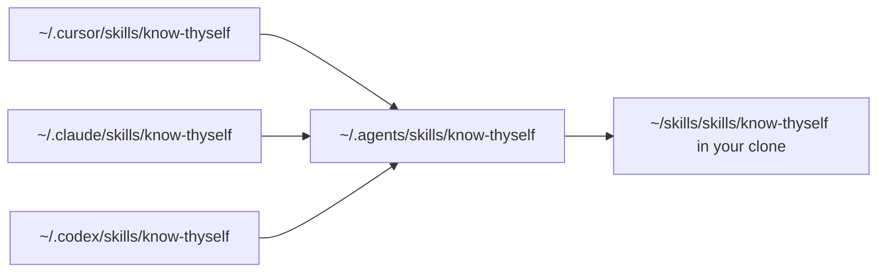

# My Agent Skills

These are the agent skills I use across Cursor, Claude Code, Codex, and anything else that reads `SKILL.md`. If you're browsing, the table below says what each one does and a single command installs it. If you want to change a skill or add one, the Layout, Checks, and Add a skill sections at the end cover how the repository fits together. Take what helps, and change what doesn't.

## Skills

| Skill | What it does | Guide |
| --- | --- | --- |
| Lock In | Turns an unsettled request into one brief you can approve before any code is written | [docs/lock-in-and-brrr.md](docs/lock-in-and-brrr.md) |
| Brrr | Has one agent build a clear task with visible progress, focused checks, and a self-review | [docs/lock-in-and-brrr.md](docs/lock-in-and-brrr.md) |
| Chill | Rewrites a dense answer in plain language and keeps its facts, caveats, and next steps | [docs/chill.md](docs/chill.md) |
| No Director's Commentary | Strips agent narration from comments, docs, and PR text, and flags type escapes and no-op try/catch in the same pass | [docs/no-directors-commentary.md](docs/no-directors-commentary.md) |
| Fresh Eyes | Overhauls a repository's Markdown docs, checks every claim against the code, and proves the result with a cold reader | [docs/fresh-eyes.md](docs/fresh-eyes.md) |
| Know Thyself | Reads your local agent conversations and reflects back how you work, with counts and quotes from your own history | [docs/know-thyself.md](docs/know-thyself.md) |
| useEffect or Not | Decides whether each React effect should stay, go, or be repaired, and names its real owner | [docs/useeffect-or-not.md](docs/useeffect-or-not.md) |

### Lock In

Use Lock In when a request still has decisions hiding inside it. It checks the code and supporting evidence, asks about the choices that could change the implementation, and writes one brief you can approve before coding starts. It always checks its understanding with you instead of silently treating its assumptions as decisions.

```sh
npx skills@latest add javonmcgilberry/skills --skill lock-in
```

[Guide](docs/lock-in-and-brrr.md) | [Skill source](skills/lock-in/SKILL.md)

### Brrr

Brrr gets clear work done. It uses one primary agent, keeps a short record as it goes, runs the right tests, and reviews the final diff. You can run it on its own when the request is already clear, or hand it a brief from Lock In.

```sh
npx skills@latest add javonmcgilberry/skills --skill brrr
```

[Guide](docs/lock-in-and-brrr.md) | [Skill source](skills/brrr/SKILL.md)

### Chill

Reach for Chill once research or planning is done and the answer reads like a committee wrote it. I tested loading it before the research instead, and agents searched more and made more tool calls without producing better research, so I run it afterward.

> Note: Chill grew out of Dillon Mulroy's tiny `/bro` prompt ([original prompt](https://x.com/dillon_mulroy/status/2075751761462051181?s=20), [follow-up](https://x.com/dillon_mulroy/status/2079238358358778142), [example in use](https://x.com/dillon_mulroy/status/2079257150824620312)). I loved how natural it sounded. Chill adds one guardrail: simplify the language without dropping the meaning.

```sh
npx skills@latest add javonmcgilberry/skills --skill chill
```

[Guide and evaluation results](docs/chill.md) | [Skill source](skills/chill/SKILL.md)

### No Director's Commentary

Reach for it when reviewing or cleaning up what an agent wrote. It catches comments that restate the code, pasted chat intros, migration history, generic TODOs, and docs that talk about themselves, and it keeps the runbook steps, why-comments, and source lists a reader actually needs.

```sh
npx skills@latest add javonmcgilberry/skills --skill no-directors-commentary
```

[Guide](docs/no-directors-commentary.md) | [Skill source](skills/no-directors-commentary/SKILL.md)

### Fresh Eyes

Reach for it when a repository's docs have drifted far enough that you no longer trust them. It leaves behind a docs check that keeps named paths, links, and scripts honest, and running it again after code changes refreshes only what moved.

```sh
npx skills@latest add javonmcgilberry/skills --skill fresh-eyes
```

[Guide](docs/fresh-eyes.md) | [Skill source](skills/fresh-eyes/SKILL.md)

### Know Thyself

Reach for it when you want to see how you work with AI coding agents. Ask and it also coaches you against public guidance, checks whether a habit changed since a date, or turns corrections you keep repeating into rules. Its script uses only Python's standard library and writes only to its own config file, data directory, and reports directory, plus any file you name when you export the corpus, so your history stays on your machine.

```sh
npx skills@latest add javonmcgilberry/skills --skill know-thyself
```

[Guide](docs/know-thyself.md) | [Skill source](skills/know-thyself/SKILL.md)

### useEffect or Not

Reach for it when reviewing React code full of effects. It names the owner of each one, keeps the effects that talk to an outside system, and moves the rest into render, an event, or the right store.

```sh
npx skills@latest add javonmcgilberry/skills --skill useeffect-or-not
```

[Guide](docs/useeffect-or-not.md) | [Skill source](skills/useeffect-or-not/SKILL.md)

## Install

Every skill is a folder under `skills/`, and its folder name is the name each method below takes.

### With the skills CLI

```sh
npx skills@latest add javonmcgilberry/skills --skill <name>
```

### By copying a folder

Clone the repository and copy the skill's folder into your agent's skills directory, which is `~/.cursor/skills/` for Cursor, `~/.claude/skills/` for Claude Code, `~/.codex/skills/` for the Codex CLI, or wherever another agent loads skills from.

```sh
git clone https://github.com/javonmcgilberry/skills.git
cp -r skills/<name> ~/.claude/skills/
```

A copy doesn't follow later changes to the repository, so copy again after you pull.

### By linking a clone

Linking makes your clone the copy every runtime loads, so an edit in the repository shows up everywhere at once.

```sh
git clone https://github.com/javonmcgilberry/skills.git ~/skills
cd ~/skills
./bin/link-skill.sh know-thyself
```

`link-skill.sh` takes exactly one name and exits 1 when `skills/<name>` doesn't exist. It creates `~/.agents/skills/` if needed and points `~/.agents/skills/<name>` at the skill's folder, with the relative target `../../skills/skills/<name>` when the clone sits at `~/skills`, so the link survives a change of username, and an absolute path anywhere else. Then, for each of `~/.cursor/skills`, `~/.claude/skills`, and `~/.codex/skills` that exists, it points `<name>` there at `../../.agents/skills/<name>`, and it skips any runtime directory that's missing.



Running it again replaces existing links. When a runtime already holds a copied folder of the skill, it skips that runtime and says so, so delete the copy and run it again. Check the result with `readlink -f ~/.agents/skills/<name>`.

## Layout

```text
skills/     Installable skill packages, one folder each with its SKILL.md
docs/       One guide per skill, plus know-thyself's reference, scorecard, and development pages
evals/      Evaluation fixtures, graders, and recorded results for Chill, Lock In, and Brrr
bin/        link-skill.sh
scripts/    check.sh, the docs check, and the docs check's tests
.github/    The CI workflow that runs scripts/check.sh
```

## Checks

Run every check from the repository root with Python 3.11 or later.

```sh
scripts/check.sh
```

It runs the docs check's tests, the docs check, and know-thyself's validator, and stops at the first failure. CI runs the same script on every push and pull request, with Python 3.11 and 3.13 (`.github/workflows/check.yml`).

The docs check, `scripts/docs_check.py`, fails when a page names a path, link, heading, script, command, or skill the repository doesn't have, and the top of the file lists its rules. It proves names exist, not that the prose around them is true.

The eval harnesses (`npm test` in `evals/chill/`, `evals/lock-in/`, or `evals/brrr/`) and the Fresh Eyes lever's tests run by hand, as their guides explain.

## Add a skill

1. **Create the package.** Add `skills/<name>/SKILL.md` with `name` and `description` in its frontmatter, and keep supporting files in folders beside it, such as `references/`. Paths in the package's pages start at the package folder, because the skill runs from there in other repositories.
2. **Write the guide.** Add `docs/<name>.md`, opening with who reads it and what it helps them do, and link the skill's source.
3. **List it here.** Add a row to the Skills table and a section with its install command, in the same order as the others.
4. **Track and link it.** Run `git add skills/<name>`, because the docs check only counts tracked packages and fails the README's install command until then, and link it with `./bin/link-skill.sh <name>` to try it in your runtimes.
5. **Run the checks.** Run `scripts/check.sh`. If the skill ships its own validator or tests, add the command to `scripts/check.sh` so CI runs it too.

## License

MIT, as [LICENSE](LICENSE) states.
