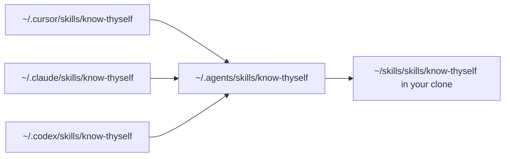

# My Agent Skills

These are the agent skills I use across Cursor, Claude Code, Codex, and anything else that reads `SKILL.md`. If you're browsing, the table below says what each one does and a single command installs it. If you want to change a skill or add one, the Layout, Checks, and Add a skill sections at the end cover how the repository fits together. Take what helps, and change what doesn't.

## Skills

| Skill | What it does | Guide |
| --- | --- | --- |
| Chill | Rewrites a dense answer in plain language and keeps its facts, caveats, and next steps | [docs/chill.md](docs/chill.md) |
| No Director's Commentary | Strips agent narration from comments, docs, and PR text, and flags type escapes and empty try/catch blocks in the same pass | [docs/no-directors-commentary.md](docs/no-directors-commentary.md) |
| Fresh Eyes | Overhauls a repository's Markdown docs, checks every claim against the code, and proves the result with a cold reader | [docs/fresh-eyes.md](docs/fresh-eyes.md) |
| Know Thyself | Reads your local agent conversations and reflects back how you work, with counts and quotes from your own history | [docs/know-thyself.md](docs/know-thyself.md) |

### Chill

Reach for Chill once research or planning is done and the answer reads like a committee wrote it. I tested loading it before the research instead, and agents searched more and made more tool calls without producing better research, so I run it afterward.

> Note: Chill grew out of Dillon Mulroy's tiny `/bro` prompt ([original prompt](https://x.com/dillon_mulroy/status/2075751761462051181?s=20), [follow-up](https://x.com/dillon_mulroy/status/2079238358358778142), [example in use](https://x.com/dillon_mulroy/status/2079257150824620312)). I loved how natural it sounded. Chill adds one guardrail: simplify the language without dropping the meaning.

```sh
npx skills@latest add javonmcgilberry/skills --skill chill
```

[Guide and evaluation results](docs/chill.md) | [Skill source](skills/chill/SKILL.md)

### No Director's Commentary

Reach for it when reviewing or cleaning up what an agent wrote. It catches comments that restate the code, pasted chat intros, migration history, generic TODOs, and docs that talk about themselves, and it keeps the runbook steps, why-comments, and source lists a reader actually needs.

```sh
npx skills@latest add javonmcgilberry/skills --skill no-directors-commentary
```

[Guide](docs/no-directors-commentary.md) | [Skill source](skills/no-directors-commentary/SKILL.md)

### Fresh Eyes

Reach for it when a repository's docs have drifted far enough that you no longer trust them. It leaves behind a docs check that keeps named paths, links, and scripts honest, and running it again after code changes refreshes only what moved.

```sh
npx skills@latest add javonmcgilberry/skills --skill fresh-eyes
```

[Guide](docs/fresh-eyes.md) | [Skill source](skills/fresh-eyes/SKILL.md)

### Know Thyself

Reach for it when you want to see how you work with AI coding agents. Ask and it also coaches you against public guidance, checks whether a habit changed since a date, or turns corrections you keep repeating into rules. Its script uses only Python's standard library and writes only to its own config file, data directory, and reports directory, so your history stays on your machine.

```sh
npx skills@latest add javonmcgilberry/skills --skill know-thyself
```

[Guide](docs/know-thyself.md) | [Skill source](skills/know-thyself/SKILL.md)

## Install

Every skill is a folder under `skills/`, and its folder name is the name each method below takes.

### With the skills CLI

```sh
npx skills@latest add javonmcgilberry/skills --skill <name>
```

### By copying a folder

Clone the repository and copy the skill's folder into your agent's skills directory, which is `~/.cursor/skills/` for Cursor, `~/.claude/skills/` for Claude Code, `~/.codex/skills/` for the Codex CLI, or wherever another agent loads skills from.

```sh
git clone https://github.com/javonmcgilberry/skills.git
cp -r skills/<name> ~/.claude/skills/
```

A copy doesn't follow later changes to the repository, so copy again after you pull.

### By linking a clone

Linking makes your clone the copy every runtime loads, so an edit in the repository shows up everywhere at once.

```sh
git clone https://github.com/javonmcgilberry/skills.git ~/skills
cd ~/skills
./bin/link-skill.sh know-thyself
```

`link-skill.sh` takes exactly one name and exits 1 when `skills/<name>` doesn't exist. It creates `~/.agents/skills/` if needed and points `~/.agents/skills/<name>` at the skill's folder, with the relative target `../../skills/skills/<name>` when the clone sits at `~/skills`, so the link survives a change of username, and an absolute path anywhere else. Then, for each of `~/.cursor/skills`, `~/.claude/skills`, and `~/.codex/skills` that exists, it points `<name>` there at `../../.agents/skills/<name>`, and it skips any runtime directory that's missing.



Running it again replaces existing links. It can't replace a copied folder, though, because `ln -sfn` puts the new link inside a real directory instead of in its place, so delete a copy at `~/.claude/skills/<name>` or the other runtime paths before you link. Check the result with `readlink -f ~/.agents/skills/<name>`.

## Layout

```text
skills/     Installable skill packages, one folder each with its SKILL.md
docs/       One guide per skill, plus know-thyself's reference, scorecard, and development pages
evals/      Chill's evaluation fixtures, graders, and recorded results
bin/        link-skill.sh
scripts/    check.sh, the docs check, and the docs check's tests
.github/    The CI workflow that runs scripts/check.sh
```

## Checks

Run every check from the repository root with Python 3.11 or later, which know-thyself's script needs, and Git.

```sh
scripts/check.sh
```

It runs three commands in order and stops at the first failure.

1. **The docs check's tests.** `python3 -m unittest -q scripts/test_docs_check.py` builds a throwaway repository per rule, plants one break only that rule should catch, and checks that clean docs pass.
2. **The docs check.** `python3 scripts/docs_check.py` reads every tracked Markdown file, the recorded eval results included, and prints one line per problem.
3. **know-thyself's package validator.** `python3 skills/know-thyself/scripts/validate_skill.py` checks that skill's files, statistics, sources, and signal fixtures, as [its development page](docs/know-thyself-development.md#package-validator) lists.

The docs check fails on any of these.

- A path in code, meaning a code span or fenced block, that has a slash, starts at a tracked top-level entry or at an entry next to the page, and doesn't exist. A leading `./` starts at the repository root, where commands run. Gitignored paths, placeholders like `<name>`, globs, home and absolute paths, and URLs are skipped.
- A missing path on a page inside a skill package, such as `skills/know-thyself/references/coach.md`. A skill runs in other repositories, so its paths start at its own folder, a path that starts with its repository path (`skills/know-thyself/...`) is checked from the repository root, and any other path names a file in the repository the skill runs in and is skipped.
- A relative link that doesn't resolve, or that climbs out of the repository even if it comes back in.
- A link fragment that isn't a heading in its Markdown target.
- A script file name without a slash, such as `convo.py`, that isn't the name of any tracked file.
- A `convo.py <command>` in code that the CLI doesn't define, or a flag after it on the same line that the command doesn't accept, which it learns by running the command with `--help`.
- An install command, `npx skills@latest add <repo> --skill <name>` or `link-skill.sh <name>`, whose skill isn't a tracked `skills/<name>/SKILL.md`.

`.github/workflows/check.yml` runs `scripts/check.sh` on every push and pull request, on Ubuntu with Python 3.11 and 3.13, with no path filters, because a renamed script breaks a doc as surely as an edited doc does.

Some checks stay out of `scripts/check.sh` and CI, so run them by hand when you touch their area.

- Chill's eval harness has Node tests, run with `npm test` in `evals/chill/`, and [the Chill guide](docs/chill.md#run-the-checks) lists its other commands.
- The Fresh Eyes lever has its own tests, run with `node --test skills/fresh-eyes/lever/docs-check.test.mts` on Node 22.18 or later, as [the Fresh Eyes guide](docs/fresh-eyes.md#what-the-lever-checks) explains.
- know-thyself's behavioral evals need a live agent and a real corpus, and CI never mines, so it skips the fixtures that depend on your vocabulary. [Its development page](docs/know-thyself-development.md#test-layers) says what each layer covers.
- Only know-thyself has a package validator, so the other skills' frontmatter and file references go unchecked beyond what the docs check reads.

The docs check proves that named paths, links, commands, and flags exist, never that the prose around them is true.

## Add a skill

1. **Create the package.** Add `skills/<name>/SKILL.md` with `name` and `description` in its frontmatter, and keep supporting files in folders beside it, such as `references/`. Paths in the package's pages start at the package folder, because the skill runs from there in other repositories.
2. **Write the guide.** Add `docs/<name>.md`, opening with who reads it and what it helps them do, and link the skill's source.
3. **List it here.** Add a row to the Skills table and a section with its install command, in the same order as the others.
4. **Track and link it.** Run `git add skills/<name>`, because the docs check only counts tracked packages and fails the README's install command until then, and link it with `./bin/link-skill.sh <name>` to try it in your runtimes.
5. **Run the checks.** Run `scripts/check.sh`. If the skill ships its own validator or tests, add the command to `scripts/check.sh` so CI runs it too.

## License

MIT, as [LICENSE](LICENSE) states.
