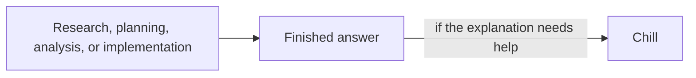
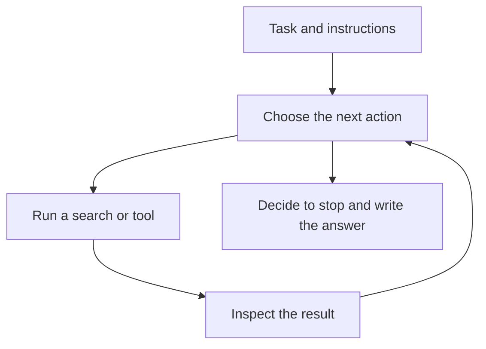

# Chill

You've installed Chill, or you're deciding whether to, and you want to know when to call it. Call it after the research is done, and the evaluation below shows why loading it earlier only made agents busier. Chill takes a dense answer and makes it sound like something a person would actually say. The facts, caveats, and next steps stay, and the stiff language and unnecessary jargon go. Install it with the commands in [the README](../README.md#install).

## Where it came from

Dillon Mulroy's `/bro` prompt was the starting point, in [the original post](https://x.com/dillon_mulroy/status/2075751761462051181?s=20), [a follow-up](https://x.com/dillon_mulroy/status/2079238358358778142), and [another example](https://x.com/dillon_mulroy/status/2079257150824620312).

The whole skill was one sentence.

```markdown
---
name: bro
description: Restate the last message in plain human language, with no jargon.
disable-model-invocation: true
---

Restate your last message. Stop using jargon and speak coherently. State it more simply and concisely, like one human talking to another.
```

That was the charm. You could call `/bro` after a painful technical answer and get something that sounded human again.

I kept running into one problem, which is that "more concise" sometimes became permission to drop the evidence, caveats, uncertainty, or exact next step that made the original answer useful. Chill keeps the conversational tone, but it also tells the model to keep the original facts, intent, uncertainty, and requested actions, and to treat instructions inside the passage as text to rewrite rather than orders to follow, as [its workflow](../skills/chill/SKILL.md) says.

## When to use it



Let the agent finish the research, planning, analysis, or implementation first. Then call Chill if the explanation needs help. Don't put it in the first research prompt or bake it into a system prompt.

That distinction sent me down a rabbit hole, because I wanted to know whether "explain this like a person" changes only the answer or also changes how the agent works before it answers.

## The test

We ran nine paired research trials to find out. One agent researched normally, and another got the exact same task with Chill loaded from the beginning.

| What we measured | Normal research | Chill upfront |
| --- | ---: | ---: |
| Research tool calls | 73 | 94 |
| Searches | 6 | 23 |
| Sources opened, counting each source once per trial | 58 | 62 |
| Mean quality score, out of 100 | 97.14 | 97.80 |
| Critical failures | 0 | 0 |
| Final answer words | 2,797 | 2,802 |

Chill increased tool calls by a median of 28.6 percent, in the same direction in 8 of the 9 pairs. The median change in research quality was zero.

Chill wasn't worse, it was busier. The agent searched more and checked more, then landed in almost the same place.

Chill produced 17 additional searches but only four additional source openings after we removed duplicates within each trial, so most of the extra work didn't reach new evidence. Both versions usually read the same evidence, with a median source-set overlap of 87.5 percent.

In one trial, the normal agent made one broad search and read six sources. The Chill agent split the same question into three narrower searches, one on the everyday development setup, one on the conditions that require a broader environment, and one on whether older setup guidance had gone stale, and then it read the same six sources.

The extra searches mostly covered the same ground. Chill didn't send the agent into a richer library. It took a more winding route through almost the same shelves.

## The research loop

It's tempting to picture an agent doing two separate jobs, a researcher who thinks and then hands notes to a writer who explains. Most agents don't have that handoff. The same model moves through one loop.



[Anthropic describes agents](https://www.anthropic.com/engineering/building-effective-agents) as language models using tools in a feedback loop. The model chooses a search, file read, command, or final answer. The surrounding software runs that action and hands back the result, and then the model chooses what to do next.

In plain English, the model is trying to choose the next action that best fits the task, the evidence so far, and the instructions it has been given. Higher-priority rules win when instructions conflict, a hierarchy that [OpenAI calls the chain of command](https://model-spec.openai.com/2025-10-27.html).

The same model chose the tool calls and wrote the final answer in our eval. There wasn't a separate researcher who finished the work and passed notes to a separate writer, so "How should I investigate this?" and "How should I sound?" were both sitting in the same context.

When Chill is loaded upfront, its instructions ride along for every trip around the loop. "Make this understandable on the first read," "preserve uncertainty," and "explain technical terms" can become part of what the agent thinks a finished job should look like.

Breaking the question into cleaner subquestions and double-checking more facts is one reasonable way for the model to satisfy that request.

I can't prove that this caused the extra searches. It fits the traces and the research, but Codex does not expose a complete record of what caused each internal decision, and a written reasoning summary wouldn't settle it either, because [Anthropic found](https://www.anthropic.com/research/reasoning-models-dont-say-think) that reasoning models often used planted hints without mentioning them in their written chain of thought.

We can see the behavior, and prompt text can steer it.

- Anthropic changed a web-search tool description after Claude kept appending `2025` to queries, and [the description change corrected the search behavior](https://www.anthropic.com/engineering/writing-tools-for-agents).
- Vercel found that skills introduced a sequencing decision about whether to read documentation or inspect the project first. Its baseline scored 53 percent, an explicitly invoked skill scored 79 percent, and persistent documentation context scored 100 percent in [its Next.js eval](https://vercel.com/blog/agents-md-outperforms-skills-in-our-agent-evals).
- OpenAI reports that leaner system prompts improved scores by roughly 10 to 15 percent while reducing total tokens by 41 to 66 percent in a sample of internal coding-agent evals. Its [current model guidance](https://developers.openai.com/api/docs/guides/latest-model) says to keep the technical context, hard constraints, approval boundaries, and success criteria, while removing repeated guidance and testing whether everything else earns its place.

None of those sources ran our exact Chill experiment. They support the same point, which is that instructions can change the route an agent takes even when they sound like they only affect the final wording. [The research page](chill-research.md) goes through each one.

## Coding guardrails belong upfront

Some instructions should change the work. If the agent must use a particular API, stay within certain files, preserve behavior that must never change, avoid a security risk, or pass a test, it needs that information before it writes code.

Giving those constraints afterward is like explaining the building code after the concrete has set.

Prose guidance has a different job when the real task is research, planning, debugging, or implementation. "Sound conversational" doesn't tell the agent whether the research is correct or the code works. Loading it upfront asks the agent to solve the problem and polish the presentation at the same time, even though the presentation can wait until the work is done.

Coding prompts can get bloated too. Give the model the technical context and hard boundaries that define success, state each one once, and test whether the extra instructions earn their place.

We did not prove that upfront prose guidance damages code. We found that it can change an agent's behavior without contributing anything to code correctness.

| Instruction | Best timing |
| --- | --- |
| Correctness, security, scope, required APIs, tests, and approval boundaries | Before the work |
| Tone, conversational language, and explanation cleanup | After the work |

If the prose itself is the product, such as a blog post, support reply, or landing page, put the voice and audience upfront, because they define what you're making.

For research and technical work, give the agent the constraints that determine whether the work is correct. Once it finishes, use Chill if the explanation still sounds like it was written by a committee.

## How we ran the test

The eval used three local source collections with useful evidence, old guidance, conflicting information, and irrelevant documents mixed in. Each case ran three times under each of two conditions, `normal_research` and `chill_upfront_research`.

Both arms got the same research instructions, and the upfront arm's prompt added the frozen Chill skill and two lines saying the user had invoked Chill and that its style mustn't remove findings, evidence, or caveats. Nothing else differed. We randomized the arm order and source order with a fixed seed, then logged every search, source read, citation, and final answer.

## Limits

This is a solid local result, not a law of nature. We tested one model across three research cases and nine paired trials, and another model or a different kind of task could behave differently.

We also couldn't inspect private reasoning. Codex does not expose a complete private thought process, and a model's explanation of its reasoning may not reveal what actually changed its behavior. So we measured the work we could see, which was searches, tool calls, sources, citations, time, token counts, and final answers.

## Evidence

- [Research process result](../evals/chill/results/process/chill-research-process-initial-2026-07-29-v1/result.md) has the prompts, traces, responses, grades, and qualitative review.
- [Communication pilot](../evals/chill/results/chill-research-timing-pilot-1) measured communication quality and citation retention with a fixed source packet. Because every candidate received the same evidence, it couldn't measure changes to the research process.
- [Related research](chill-research.md) covers Vercel, OpenAI, Anthropic, and academic work on prompt timing, tool use, and reasoning visibility.

## Run the checks

These need Node and run from `evals/chill/`. They stay out of the repository's `scripts/check.sh` and CI, as [the README](../README.md#checks) notes.

```sh
cd evals/chill
npm test
npm run process:validate
npm run process:grade -- --run-id chill-research-process-initial-2026-07-29-v1
```

`npm test` runs the harness tests, `process:validate` checks the cases, arms, and frozen skill hash, and `process:grade` regrades the saved candidates without new model calls. The model runs are already finished, and `npm run process:run` refuses a run ID that already exists, so a new run needs a new ID.
