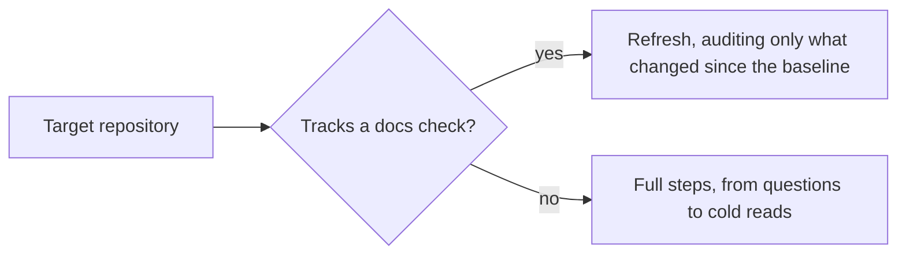

# Fresh Eyes

You want a repository's docs to be trustworthy again, or you've installed Fresh Eyes and want to know what it will do to your repository before you run it. Fresh Eyes overhauls a repository's Markdown docs until a stranger can learn the system from the docs alone. The test is concrete, since a cold reader who sees only the Markdown answers a fixed set of newcomer questions, and a checker grades each answer against the code. The code is the only source of truth, so another doc never counts as evidence for a claim.

Your agent coordinates the work and hands writing, cold reading, and checking to subagents. A full overhaul also adds a docs check to the repository, so paths, links, and scripts named in the docs keep matching the code after the overhaul ends.

Install it with the commands in [the README](../README.md#install), then read the [skill](../skills/fresh-eyes/SKILL.md), or start with the [subagent briefs](../skills/fresh-eyes/prompts.md).

## When to use it

Reach for it when the docs have drifted far enough that you no longer trust them, when you want an accuracy audit of a repository's Markdown, when a batch of code changes has landed and the docs need to catch up, or when sibling repositories that implement the same thing for different providers should share one doc layout. The `/fresh-eyes` command and requests like "overhaul the docs" or "refresh the docs after these changes" all trigger it.

It's a long, multi-agent job that ends with a cold-read score and a hand-back report, so it isn't the tool for fixing a single typo or rewording one page.

## Package layout

```text
skills/fresh-eyes/
├── SKILL.md                     The two branches, the lever rules, and the writing rules
├── questions.md                 Template for the 10 to 12 newcomer questions
├── ia.md                        Template for the information architecture
├── prompts.md                   Briefs for the writer, cold reader, checker, and fix writer
└── lever/
    ├── docs-check.mts           The docs check to copy into the target repository
    └── docs-check.test.mts      Its seeded tests
```

## Two branches

The agent picks a branch before anything else.



A repository that already tracks a docs check, at `<repo>/scripts/docs-check.mts` or the path and language an earlier pass adapted it to, such as this repository's `scripts/docs_check.py`, has had an overhaul, so it gets a refresh. Every other repository gets the full steps. In both, the work happens where you say, in your checkout, a branch, or a worktree, and you decide how to handle any uncommitted or overlapping work. The audit trail lives in a `.audit/` directory that's added to Git's local exclude file so it never gets committed.

### Full steps

The full overhaul runs ten steps. Steps 1 to 9 each end on a "Done when" condition the agent has to meet before moving on, and step 10 hands the result back.

1. **Set up.** It reads the repository's agent files, README, and PR conventions, works where you said, records that the full check was green, and copies the steps into `.audit/docs.todo.md`.
2. **Fix the questions.** It writes 10 to 12 newcomer questions from [questions.md](../skills/fresh-eyes/questions.md) into `.audit/questions.md` before anyone rewrites a page, so the test can't be bent around the new docs.
3. **Build the lever.** It copies the docs check and its test into the target repository, adapts them, wires them into the check script, and adds a CI workflow with no path filters, because renaming a code file breaks docs as surely as editing a doc does. The check's first findings on the untouched docs become the audit's first leads, and the lever lands in its own commit.
4. **Design the information architecture.** It fills [ia.md](../skills/fresh-eyes/ia.md) into `.audit/docs.ia.md`, naming the readers, one owner page per fact, the README's shape, and a fate for every tracked Markdown file (keep, rewrite, merge, or delete), each decided with evidence.
5. **Audit and rewrite.** A single writer logs every factual claim with a verdict and a code path in `.audit/docs.audit.tsv`, then rewrites the docs to the architecture. Rules in agent files keep their meaning unless the code disproves them, and every change to one goes in `.audit/docs.rule-changes.md`.
6. **Review the writer.** The coordinator runs `git status` and `git log` itself, throws away formatting churn from editor hooks, reads the README, and checks in code any security or data claim the writer raised.
7. **Cold read.** It exports only the tracked Markdown to a scratch directory, a fresh reader answers the questions from that export, and a separate checker grades each answer against the code and returns a list of real doc defects.
8. **Fix and read again.** One fresh writer applies the fix list, then a new cold read runs, and the loop repeats while the score rises and real defects remain.
9. **Stress-test the design.** The coordinator reads the whole set as a newcomer and writes `.audit/design-stress-test.md`, saying where the architecture is the right tradeoff and where it isn't, with evidence for every item.
10. **Hand back.** It runs the full check, confirms no commit credits an agent, writes the audited commit to `.audit/docs.baseline`, and reports the counts, scores, rule changes, and the lever's result. It pushes or opens draft PRs only when you say so, and names security gaps there by category only.

### Refresh

A refresh keeps the existing layout and audits only what the code changed since the last pass, so it's much shorter. It starts from the commit in `.audit/docs.baseline`, or from the last commit that changed a tracked Markdown file when there's no baseline, and tells you which one it chose.

It runs the docs check on the default branch's head and treats every failure as a defect in scope. Then it maps each changed file to the doc claims it reaches, using `.audit/docs.audit.tsv` when it exists, or a search of the docs for each changed path, script, env key, route, export, and port when it doesn't, plus the pages that own the changed behavior. One writer checks and fixes those claims inside the existing layout, since adding a page or changing a page's job is an overhaul decision that needs your go-ahead. A cold read on just the stored questions whose answers touch the changed pages closes it out, and the stress test is skipped unless the change altered the architecture.

## What the lever checks

The lever is [lever/docs-check.mts](../skills/fresh-eyes/lever/docs-check.mts), a TypeScript script for Node that reads every Markdown file Git tracks and prints one line per problem, exiting 1 when there is one. It fails on these.

- A repository path in code (a code span or a fenced block) that doesn't exist. A path with a slash resolves from the page's directory when it starts with `../` or with an entry that exists next to the page, and from the repository root otherwise, and it's checked when the result starts at a tracked top-level entry. Paths Git ignores and placeholders like `<site-id>` pass.
- A relative link that doesn't resolve, or that leaves the repository, even when it comes back in at a real file.
- A link anchor that matches no heading or `<a id>` in its target, with headings turned into anchors the way GitHub does it.
- A `pnpm <script>` that neither the root `package.json` nor the page's own workspace package defines, a `pnpm --filter <package> <script>` whose package or script doesn't exist, or a `pnpm --recursive <script>` that no package defines. pnpm's own commands, such as `install` and `exec`, aren't checked.

History files such as changelogs go in its exclusion list, because their compare links point at tags rather than files. The skill asks for every rule to be proven by a seeded break that fails without that rule, and after the check is renamed, for a dead path to be seeded in a real doc to show the check still runs. To run its tests here, use Node 22.18 or later, which runs `.mts` files without a build step.

```sh
node --test skills/fresh-eyes/lever/docs-check.test.mts
```

This repository's docs check, [scripts/docs_check.py](../scripts/docs_check.py), is a Python version of the lever adapted for skill packages. It has no pnpm rule, matches anchors to headings only, and adds script, command, and install rules, all listed at the top of the file. The lever's own tests stay out of `scripts/check.sh` and CI.

## Subagent roles

The main agent is the coordinator. It sets up each checkout, fixes the questions, reviews every writer's work in Git, and writes the stress test, and it briefs each subagent from [prompts.md](../skills/fresh-eyes/prompts.md), passing paths rather than pasted content, and routes a strong model to writing and checking and a small one to the cold reader, because a newcomer's view is the point.

| Role | Step | Job |
| --- | --- | --- |
| Writer | 5 | The only writer in its checkout. Logs every claim with a verdict and evidence, rewrites to the architecture, and commits in small one-line commits without pushing. |
| Cold reader | 7 | Reads only the exported Markdown, answers each question with the files and headings it used and a confidence, writes "NOT IN DOCS" where the docs fall short, and lists every confusing or contradictory spot. |
| Checker | 7 | Grades each answer against the code (correct 1, partly 0.5, wrong 0), says whether the docs or the reader caused each error, and ends with a numbered fix list of real doc defects only. |
| Fix writer | 8 | Applies the fix lists after verifying each item in code, skips any that's wrong with a reason, and keeps shared tables byte-identical across sibling repositories. |

## Writing rules

Every page the writer produces opens with its reader and its job. Diagrams are Mermaid, examples come from real files or real runs, and env keys appear by name and never by value. The writer follows your prose style and runs the repository's own lint on any code it ships.
