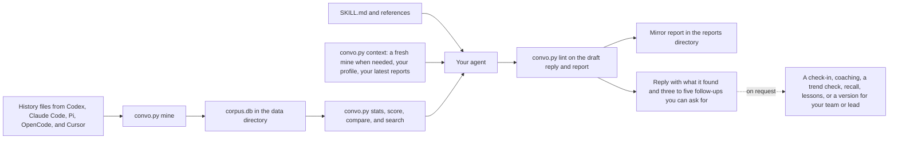

# know-thyself

You do much of your work through AI coding agents and want to see how you work with them, or you've installed know-thyself and want to know what it reads, what it keeps, and what to ask it. know-thyself is an agent skill that reads the conversations you've had with those agents and reflects back how you work, what you're good at, where friction shows up, and how that's changed, with every pattern backed by counts and short quotes from your own history. It describes rather than prescribes, and when you ask, it also checks in on your last two weeks, coaches you against public guidance, checks whether a habit changed since a date, recalls what you decided, turns corrections you keep repeating into rules, and writes a version of how you work for your team or your lead. Run it every few months, and again when a new model ships, so you notice when you're still working the way an older model needed.

Everything stays on your machine. The script uses only Python's standard library, opens other tools' history read-only, replaces credentials before anything is stored, and writes only to its own config file, data directory, and reports directory, which by default sit outside every repository, plus any file you name when you export the corpus.

## At a glance

| Part | Where | What it is |
| --- | --- | --- |
| Skill | `skills/know-thyself/` | `SKILL.md` and `references/`, the instructions your agent follows |
| CLI | `skills/know-thyself/scripts/convo.py` | The script that mines, measures, scores, and searches |
| Data directory | `~/.local/share/know-thyself/` | `corpus.db`, a SQLite file holding your past turns, which survive even after a tool deletes its own copy, and `ME.md`, your profile |
| Reports | `~/.local/share/know-thyself/reports/` | The mirror, check-in, coaching, team, and lead reports your agent writes |

You need Python 3.11 or later. Install the skill with the skills CLI, a copied folder, or a linked clone, as [the README](../README.md#install) shows.

From a clone, build your corpus once from the repository root, then see where everything landed. Outside a clone, run the same commands from the installed folder, such as `python3 ~/.agents/skills/know-thyself/scripts/convo.py paths` after `link-skill.sh`, or `~/.claude/skills/know-thyself/scripts/convo.py` after a copy into Claude Code.

```sh
python3 skills/know-thyself/scripts/convo.py setup
python3 skills/know-thyself/scripts/convo.py paths
```

`setup` writes the config, mines every history it can find, bringing in an older version's files the first time, and runs the signal checks. It doesn't schedule anything, but every run of the skill starts with `convo.py context`, which mines again when the corpus is over a day old, and you can run `convo.py mine` yourself whenever you want fresh numbers. You can also leave the first run to your agent, because `context` tells it to run `setup` when there's no corpus yet. Start your agent and ask it something like "Let's do a run" or "How do I work with agents?" If it answers without using the skill, name the skill in your request.

## How it works



**Mining.** `mine` reads each tool's history from its usual place under your home directory and keeps only the turns where a user spoke. It replaces credentials it recognizes, drops injected instructions and slash-command noise, and tags each turn `human`, `subagent`, or `harness`, so subagent threads and scripted prompts never count as yours, and you can add patterns for your own tools' prompts to the config file. Then it records which signals each human turn shows, after stripping code, logs, links, and paths, and merges the result into `corpus.db`. Later runs parse only new or changed files, and turns whose source file is gone stay in the corpus, so the corpus outlives any tool that prunes its history.

**Querying.** `stats`, `score`, `compare`, and `search` read only the corpus and default to human turns. `score` builds the scorecard by comparing your last 60 days with the 180 days before, line by line, with a 95% range on every count and a correction for testing up to 30 habits at once, and `score --cards` turns chosen lines into short plain-language cards. `compare` checks whether one habit changed after a date you name. `search` returns the actual turns behind a number, which is how a rate gets checked before anyone trusts it.

**Answering.** When you ask a question, your agent reads `SKILL.md`, whose first step runs `convo.py context`, which mines again when the corpus is over a day old or was built under older rules and prints your profile, your latest reports, and anything to do first. Then it picks a mode, and loads the reference that mode needs, plus the shared voice file before it writes. Coaching also reads `references/practices.md` and takes titles and links from `references/sources.json`. A request without a clear other mode, such as "let's do a run" or "what am I good or bad at", gets the mirror. Your agent runs the commands, reads about 150 of your turns, most of them from the last 90 days, plus up to 40 that use compact terms such as "source of truth" or "blast radius", and writes a report on how you work, what you're good at, where friction shows up, the words you lean on when any stand out, and what's changed, with plain counts and short dated quotes and no advice. The reply opens with one sentence on how you work, then what you're good at and where friction shows up, then where the full report is saved, with its path and an offer to show any part of it in the chat, and closes with three to five follow-ups written from that run, which you can paste to go further, and one sentence on what the run covered. Before replying, your agent runs `convo.py lint` on the report and its draft reply, which checks that every dated quote is something you typed within a day of its date, that the sections are in order, and that nothing from your profile's Keep out list appears, and it fixes whatever that finds.

**Your profile.** Say "set me up" and your agent asks, in one message, what your history can't show: your role, what you want from this, who will read what it writes, what it must never quote or name, and how to talk to you. It writes the answers to `ME.md` in the data directory, every later run reads it, and you can edit it any time. Until it exists, a run offers it once and never waits on it.

## Modes

| Mode | Runs when you ask | What you get |
| --- | --- | --- |
| Mirror | "Let's do a run", "How do I work?", or anything without a clear other mode | A description of how you work, written to `YYYY-MM-DD-mirror.md`, meant to take under three minutes. Ask it to go deeper and it reads 300 or more turns across your whole history. |
| Check-in | "How have I been doing the last two weeks?" | `YYYY-MM-DD-checkin.md`, a short look at the last 14 days against the 180 days before them, from `convo.py score --recent-days 14 --baseline-days 180`. With fewer than 10 sessions in 14 days it widens to 30 and says so, and with fewer than 10 in 30 it says there's too little recent work to compare. It names only the habits `score` marks up or down, each with counts on both sides and a dated quote, then what held from your latest mirror, two or three quotes from the window, and what held, slipped, or is new since your last check-in. Like a mirror it gives no advice, and the reply makes at most two offers. |
| Coach | "Coach me on how I start tasks", "How can I get better at reviews?", "Score my prompts" | Coaching scoped to what you asked, with up to three habit cards from `convo.py score --cards`, one of your own recent prompts shown before and after a rewrite, each change checked against the guides, a few next steps with a short why, and the sources those steps relied on at the end. Ask to see all the habits for the full 30-line scorecard. |
| Trend | "Has splitting work across agents changed since August?" | Whether a habit changed after a date, with counts on both sides |
| Recall | "What did I decide about the cache?" | What you decided, when, and in which session |
| Lessons | "Stop me repeating the same correction" | Proposed rules, checks, or instruction lines for corrections that repeat, applied only after you approve them |
| Share | "Make a version I can share" | `YYYY-MM-DD-shareable.md`, in the first person, on your working style, strengths, tools, and what's changed, with no quotes, paths, links, or names, and no friction unless you say what you're happy to share |
| Lead | "My director asked how I work, help me answer" | `YYYY-MM-DD-lead.md`, a first-person answer covering how you work, where you're strongest, what you're working on (only what you agree to share), and how you work with AI agents |
| Init | "Set me up" | Your profile, `ME.md`, as described above |

Call the skill with nothing else, as in "know thyself", or ask what it can do, and it recommends two or three of these from what `context` printed, such as a first mirror, a fresh one when yours is over a month old, a check-in when you have a recent mirror and no check-in in the last 14 days, or coaching on the friction your last mirror found. Each pick comes as words you can paste, and after the picks it shows a What you can do list with one example request for every mode above. It runs nothing until you pick. Read a version for others before anyone else does.

## Limits

- **Counts are word matches.** Each scorecard line is a set of patterns run on what you typed, so a habit expressed in other words goes uncounted and an unrelated sentence can match by accident. Treat every rate as a floor and read a sample before believing it.
- **Some Cursor times are stand-ins.** When Cursor didn't store a message's time, or stored one that isn't later than the message before it, the script uses a time just after that earlier message, or the conversation's creation time, so the order holds but such a session can land in the wrong window or month.
- **Some history can't be read.** ChatGPT desktop keeps its history in encrypted `*.data` files the script can't parse, so they're counted and reported as unread, a file or Cursor read that raises an error adds no turns and is counted as `files_failed`, while a line or OpenCode file that isn't valid JSON is skipped without a count in the coverage summary, and a tool that keeps its history somewhere other than the paths in [the reference](know-thyself-reference.md#history-sources) isn't read at all.
- **Origin tags are heuristics.** Harness prompts are recognized by their working directory and a fixed list of phrases, mostly opening words, so an unusual scripted prompt can count as yours, and a message of yours that opens "You are a" is set aside as harness. Pass `--origin human,harness` to see what was set aside, and add `harness_patterns` to the config file for your own tools, as [the reference](know-thyself-reference.md#where-data-and-config-live) shows.
- **Redaction covers known formats only.** Keys, tokens, and password assignments in common shapes are replaced, but a secret in an unfamiliar format stays in the corpus as typed, so treat the data directory as sensitive.
- **The comparison is only with yourself.** There's no overall grade and no outside benchmark, so the scorecard can say you name your finish line more often than you used to, never that you're good at it.
- **The windows are anchored to today.** Lately always ends today, the last 60 days unless `--recent-days` changes it, and `compare` always runs up to today, so comparing two closed periods in the past needs two filtered runs, as [the scorecard guide](know-thyself-scorecard.md#lately-and-before) explains.

## Where to read next

- **New users** should read [the scorecard guide](know-thyself-scorecard.md) before trusting a number.
- **Contributors** should read [development](know-thyself-development.md) for the contract a change must keep and the checks that prove it.
- **Reviewers** need the contract and the test layers in [development](know-thyself-development.md).
- **Agents** follow [SKILL.md](../skills/know-thyself/SKILL.md) and the files in `skills/know-thyself/references/`.

| To | Read |
| --- | --- |
| Look up a command, flag, path, environment variable, or data file | [Reference](know-thyself-reference.md) |
| See which tools are read and where | [History sources](know-thyself-reference.md#history-sources) |
| Change where data or reports live | [Where data and config live](know-thyself-reference.md#where-data-and-config-live) |
| Understand a scorecard cell or verdict | [Reading the scorecard](know-thyself-scorecard.md) |
| Check whether a habit changed after a date | [Checking a change with compare](know-thyself-scorecard.md#checking-a-change-with-compare) |
| Change a signal rule | [Signal fixtures](know-thyself-development.md#signal-fixtures) |
| Run the repository's checks | [Checks in the README](../README.md#checks) |
| See what know-thyself's own tests cover | [Test layers](know-thyself-development.md#test-layers) |
| Compare two versions of the skill | [Evaluation protocol](../skills/know-thyself/evals/JUDGE.md) |

## Where the advice comes from

The practices and habits in this skill are a distillation of public guidance from Anthropic (the Claude Code and Claude API docs, its engineering posts, and the free Anthropic Academy courses), OpenAI (the API prompting docs, the Codex guides, its prompting guidance for GPT-5.6 Sol and GPT-6 Astra, and its practical guide to building agents), Felix Rieseberg's essay on ambition, the pstack principles, a talk on shipping thousands of PRs a month with agents, a post on prompting newer models less, OpenAI's harness engineering post, and two research papers summarized on 1kpapers. Every practice in [references/practices.md](../skills/know-thyself/references/practices.md) links the sources it comes from and says where a piece is this skill's own advice. Coaching lists the references its suggestions relied on in one Sources section at the end, never inline, and a mirror cites none because it gives no advice. The scorecard measures how often you show each habit, not how you rank against anyone else. Every source is listed below and in `skills/know-thyself/references/sources.json`.

- Anthropic (Claude Code Docs), [Best practices for Claude Code](https://code.claude.com/docs/en/best-practices)
- Anthropic (Claude Code Docs), [How Claude remembers your project](https://code.claude.com/docs/en/memory)
- Anthropic (Claude Code Docs), [Extend Claude with skills](https://code.claude.com/docs/en/skills)
- Anthropic (Claude Code Docs), [Create custom subagents](https://code.claude.com/docs/en/sub-agents)
- Anthropic (Claude Code Docs), [Automate actions with hooks](https://code.claude.com/docs/en/hooks-guide)
- Anthropic (Claude Code Docs), [Hooks reference](https://code.claude.com/docs/en/hooks)
- Anthropic (Claude Code Docs), [Run Claude Code programmatically](https://code.claude.com/docs/en/headless)
- Anthropic (Claude Code Docs), [Common workflows](https://code.claude.com/docs/en/common-workflows)
- Anthropic (Claude Code Docs), [Checkpointing](https://code.claude.com/docs/en/checkpointing)
- Anthropic (Claude Code Docs), [Plugins overview](https://code.claude.com/docs/en/plugins)
- Anthropic (Claude Code Docs), [Code Review](https://code.claude.com/docs/en/code-review)
- Anthropic (Claude Code Docs), [Manage costs effectively](https://code.claude.com/docs/en/costs)
- Anthropic (Claude Code Docs), [How Claude Code works](https://code.claude.com/docs/en/how-claude-code-works)
- Anthropic (Claude Code Docs), [Security](https://code.claude.com/docs/en/security)
- Anthropic (Claude Code Docs), [Run prompts on a schedule](https://code.claude.com/docs/en/scheduled-tasks)
- Anthropic (Claude Platform Docs), [Prompting best practices](https://platform.claude.com/docs/en/build-with-claude/prompt-engineering/claude-prompting-best-practices)
- Anthropic (Claude Platform Docs), [Reduce hallucinations](https://platform.claude.com/docs/en/test-and-evaluate/strengthen-guardrails/reduce-hallucinations)
- Anthropic (Claude Platform Docs), [Choosing the right model](https://platform.claude.com/docs/en/about-claude/models/choosing-a-model)
- Anthropic (Claude Platform Docs), [Define success criteria and build evaluations](https://platform.claude.com/docs/en/test-and-evaluate/develop-tests)
- Anthropic (Claude Platform Docs), [Skill authoring best practices](https://platform.claude.com/docs/en/agents-and-tools/agent-skills/best-practices)
- Anthropic (Engineering), [Building effective AI agents](https://www.anthropic.com/research/building-effective-agents)
- Anthropic (Engineering), [Effective context engineering for AI agents](https://www.anthropic.com/research/effective-context-engineering-for-ai-agents)
- Anthropic (Engineering), [How we built our multi-agent research system](https://www.anthropic.com/research/multi-agent-research-system)
- Anthropic (Engineering), [Equipping agents for the real world with Agent Skills](https://www.anthropic.com/research/equipping-agents-for-the-real-world-with-agent-skills)
- Anthropic Academy (Skilljar course page), [Claude Code in Action](https://anthropic.skilljar.com/claude-code-in-action)
- Anthropic Academy (Skilljar course page), [Introduction to subagents](https://anthropic.skilljar.com/introduction-to-subagents)
- Anthropic Academy (Skilljar course page), [Introduction to agent skills](https://anthropic.skilljar.com/introduction-to-agent-skills)
- Anthropic, Dakan and Feller (AI Fluency course handout), [AI Fluency: Key Terminology Cheat Sheet (PDF)](https://www-cdn.anthropic.com/4396730ed190e691a3712cf2fd6bfe35509deca2.pdf)
- Anthropic, Dakan and Feller (AI Fluency course handout), [The 4Ds: Diligence (PDF)](https://www-cdn.anthropic.com/34612aacbf37f6aa12140fc0a1aa216b63263aac.pdf)
- Anthropic (Claude Academy tutorial), [Writing an AI diligence statement](https://academy.claude.com/tutorials/writing-an-ai-diligence-statement)
- OpenAI, [Prompt engineering | OpenAI API](https://developers.openai.com/api/docs/guides/prompt-engineering)
- OpenAI, [Reasoning best practices | OpenAI API](https://developers.openai.com/api/docs/guides/reasoning-best-practices)
- OpenAI Cookbook, [Codex Prompting Guide](https://developers.openai.com/cookbook/examples/gpt-5/codex_prompting_guide)
- OpenAI, [Best practices | ChatGPT Learn (Codex)](https://learn.chatgpt.com/guides/best-practices)
- OpenAI, [Prompting | ChatGPT Learn (ChatGPT + Codex)](https://learn.chatgpt.com/docs/prompting)
- OpenAI (API docs), [Prompting guidance for GPT-5.6 Sol](https://developers.openai.com/api/docs/guides/prompt-guidance-gpt-5p6.md)
- OpenAI (Developers blog), [Rethinking skills and prompts for GPT-6 Astra](https://developers.openai.com/blog/rethinking-skills-and-prompts-for-gpt-6-astra)
- OpenAI, [A practical guide to building agents (PDF)](https://cdn.openai.com/business-guides-and-resources/a-practical-guide-to-building-agents.pdf)
- Felix Rieseberg, [How to be more ambitious: A tutorial for humans with models](https://felixrieseberg.com/how-to-be-more-ambitious-a-tutorial-for-humans-with-models/)
- pstack-claude (GitHub), [Prove It Works](https://github.com/michael-denyer/pstack-claude/blob/HEAD/plugins/pstack/skills/principle-prove-it-works/SKILL.md)
- pstack-claude (GitHub), [Sequence work into verifiable units](https://github.com/michael-denyer/pstack-claude/blob/HEAD/plugins/pstack/skills/principle-sequence-verifiable-units/SKILL.md)
- pstack-claude (GitHub), [Encode Lessons in Structure](https://github.com/michael-denyer/pstack-claude/blob/HEAD/plugins/pstack/skills/principle-encode-lessons-in-structure/SKILL.md)
- pstack-claude (GitHub), [Attack the Premise](https://github.com/michael-denyer/pstack-claude/blob/HEAD/plugins/pstack/skills/principle-attack-the-premise/SKILL.md)
- Matt Pocock (YouTube), [LIVE: Poteto (creator of pstack) on shipping 1,000s of PRs a month at SpaceX](https://www.youtube.com/watch?v=MN9dGgmLyso)
- OpenAI, [Harness engineering: leveraging Codex in an agent-first world](https://openai.com/index/harness-engineering/)
- 1kpapers (paper summary), [Trace2Skill: Distill Trajectory-Local Lessons into Transferable Agent Skills](https://www.1kpapers.com/papers/trace2skill-distill-trajectory-local-lessons-into-transferable-agent-skills)
- 1kpapers (paper summary), [OpenComputer: Verifiable Software Worlds for Computer-Use Agents](https://www.1kpapers.com/papers/opencomputer-verifiable-software-worlds-for-computer-use-agents)
- Addy Osmani (X), [You're probably overprompting Claude](https://x.com/addyosmani/status/2115688494865465370)

## Credits

- **Felix Rieseberg**, [How to be more ambitious: A tutorial for humans with models](https://felixrieseberg.com/how-to-be-more-ambitious-a-tutorial-for-humans-with-models/). The scorecard's six ambition lines, `altitude`, `hard_target`, `raw_material`, `expert_method`, `range_fields`, and `aim_high`, come from this article's Altitude, Depth, and Range, and three other lines, `outside_judge`, `role_framing`, and `challenge_assumptions`, cite it too.
